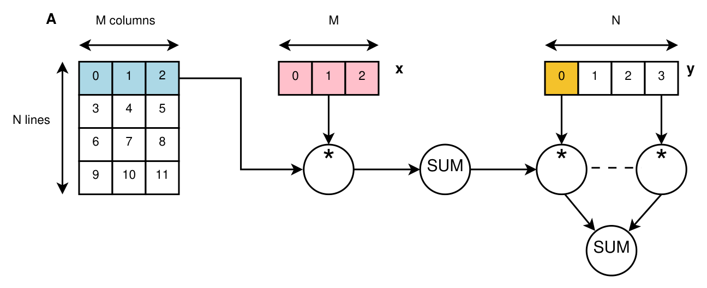
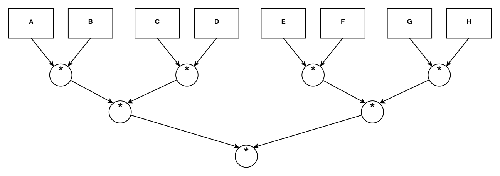

# CUDA : étude de performance de calculs parallèles sur GPU

Rapport et code sur la programmation GPU avec CUDA : calcul de π, produit matrice-vecteur, produit de matrices en `double`, `float` et `half`, et enchaînement de produits de matrices avec des streams.

Le rapport est le notebook [`rapport_CUDA.ipynb`](rapport_CUDA.ipynb). Sa version PDF est [`rapport_CUDA.pdf`](rapport_CUDA.pdf).

## Énoncé de départ

Cette section reprend le sujet du TD n°2 (CUDA) de Jonathan Rouzaud-Cornabas (INSA Lyon), traduit et adapté en français. Le PDF du sujet n'est pas inclus dans ce dépôt : tout ce qui suit provient de ce sujet.

### Consignes

Les versions incomplètes des codes sont disponibles sur Moodle (ce sont les mêmes que pour le TP OpenMP). Deux semaines après la séance pratique, il faut envoyer un rapport (évaluation de performance et courte analyse pour chaque partie) accompagné des codes complétés. L'évaluation de performance et l'analyse comptent autant que le code. Le travail se fait seul ou en binôme (pas plus) et le rapport est noté.

Le sujet annonce 5 parties mais en contient 4, chacune plus complexe que la précédente. Le minimum demandé est les deux premières parties.

### Méthodologie d'évaluation des performances

1. Modifier la partie des codes qui mesure la performance pour enregistrer la valeur (et de préférence aussi les paramètres, par exemple la taille de la matrice) dans un fichier, par exemple un CSV. Cela facilite l'agrégation des mesures de plusieurs exécutions et évite de recopier les temps à la main dans un tableur, ce qui est une source d'erreurs.
2. Automatiser les exécutions multiples (selon une plage de valeurs pour chaque paramètre).
3. Répéter chaque exécution plusieurs fois (au moins 10 fois).
4. Les figures doivent présenter des valeurs agrégées (moyenne, médiane et/ou écart-type).
5. Le langage de script est libre (bash est le minimum, et un notebook Jupyter est plutôt la bonne façon de faire).
6. Même chose pour les figures (Python avec NumPy et Matplotlib, ou R avec ggplot2, sont de bons choix, et il faut éviter Excel même si cela fonctionne).
7. Toutes les expériences doivent être faites et évaluées sur le même ordinateur (au moins la même configuration, ici le même GPU).
8. Optionnel : comparer les performances sur un autre ordinateur (voir Moodle pour accéder aux machines de Grid'5000).
9. Optionnel : rendre la démarche reproductible pour faciliter la reproduction du travail, y compris sur un autre ordinateur.

### Partie 1 : calcul de π

Le code séquentiel de départ est `src/1_0_pi_depart.cpp`.

- Question 1.1 : porter le code en CUDA (kernel, allocation mémoire, copies vers et depuis le GPU) avec un parallélisme de base : un thread par bloc, N blocs, chaque thread calculant une plage de valeurs
- Question 1.2 : passer à plusieurs threads par bloc (réduction à deux niveaux)
- Question 1.3 : utiliser la mémoire partagée et les opérations atomiques
- Question 1.4 : implémenter une réduction multi-étapes complète
- Question 1.5 : évaluer la performance pour 1 000 000, 100 000 000, 10 000 000 000 et 1 000 000 000 000 pas, avec différents nombres de threads par bloc (par exemple 1, 32, 64, 128, 256) et de pas par thread (par exemple 1, 64, 256, 1024)
- Question 1.6 : tracer des figures de performance
- Question 1.7 : expliquer les performances

### Partie 2 : produit matrice-vecteur

Le code séquentiel à compléter est fourni avec le sujet, la version complétée est `src/2_1_vector.cpp`. La figure 1 décrit l'algorithme (il est aussi en commentaire dans le code).



*Figure 1 : workflow de la partie 2 (produit matrice-vecteur). La matrice A de N lignes et M colonnes est multipliée ligne par ligne par le vecteur x, chaque somme est multipliée par l'élément correspondant du vecteur y, puis tous les résultats sont additionnés.*

- Question 2.1 : compléter le code pour obtenir un code séquentiel fonctionnel
- Question 2.2 : porter le code en CUDA avec un thread par bloc et un bloc par ligne de la matrice A
- Question 2.3 : évaluer la performance pour N = 2, 4, 8, 10, 12, 14 et 16 et M = 1, 3, 7, 9, 11, 13 et 15 (ce sont les exposants de 2 utilisés par le code, la taille vaut 2^N et 2^M)
- Question 2.4 : tracer des figures de performance
- Question 2.5 : expliquer les performances
- Question 2.6 : ajouter le support de plusieurs threads par bloc et des opérations atomiques
- Question 2.7 : évaluer la performance pour les mêmes valeurs de N et M
- Question 2.8 : tracer des figures de performance
- Question 2.9 : expliquer les performances
- Question 2.10 : ajouter le support de la mémoire partagée et des opérations atomiques
- Question 2.11 : évaluer la performance pour les mêmes valeurs de N et M
- Question 2.12 : tracer des figures de performance
- Question 2.13 : expliquer les performances

### Partie 3 : produit de matrices et précision des flottants

Le code séquentiel de départ est `src/3_0_matrix_mul_depart.cpp`.

- Question 3.1 : porter le code en CUDA (un thread par bloc)
- Question 3.2 : évaluer la performance pour N = 1000, 4000, 8000, 12000, 18000 et M = 1000, 4000, 8000, 12000, 18000
- Question 3.3 : tracer des figures de performance
- Question 3.4 : expliquer les performances
- Question 3.5 : améliorer le kernel pour utiliser plusieurs threads par bloc, la mémoire partagée et les opérations atomiques
- Question 3.6 : évaluer la performance pour les mêmes valeurs de N et M
- Question 3.7 : tracer des figures de performance
- Question 3.8 : expliquer les performances
- Question 3.9 : modifier le code pour passer le type de la matrice de `double` à `float`
- Question 3.10 : évaluer la performance pour les mêmes valeurs de N et M
- Question 3.11 : tracer des figures de performance
- Question 3.12 : expliquer les performances
- Question 3.13 : modifier le code pour passer le type de la matrice de `double` à `half` (inclure `half.hpp`, le type est `half_float::half`)
- Question 3.14 : évaluer la performance pour les mêmes valeurs de N et M
- Question 3.15 : tracer des figures de performance
- Question 3.16 : expliquer les performances

### Partie 4 : enchaînement de produits de matrices

On peut enchaîner plusieurs produits de matrices, par exemple comme dans la figure 2.



*Figure 2 : enchaînement de produits de matrices. Huit matrices (A à H) sont multipliées deux à deux, puis les quatre résultats sont multipliés deux à deux, puis les deux derniers résultats sont multipliés. Cela fait 7 produits répartis sur 3 niveaux.*

- Question 4.1 : proposer une implémentation parallèle de ce workflow en réutilisant le code de la partie précédente (les streams semblent une bonne idée)
- Question 4.2 : évaluer la performance pour N = 1000, 4000, 8000, 12000, 18000 et M = 1000, 4000, 8000, 12000, 18000
- Question 4.3 : tracer des figures de performance
- Question 4.4 : expliquer les performances

Les grilles de tailles réellement utilisées dans ce dépôt diffèrent de celles du sujet pour les parties 1 (grille de la question 1.5), 2 (dernière paire exclue), 3 et 4. Les raisons sont expliquées dans les sections 1.5, 2.3, 3.2 et 4.2 du rapport. La question 3.13 utilise de plus le type `__half` de CUDA à la place de `half.hpp`, qui ne fonctionne que sur le processeur (voir la section 3.13).

## Contenu du dépôt

| Partie | Sujet | Sources (`src/`) |
|---|---|---|
| 1 | Calcul de π : un thread par bloc, réduction à deux niveaux, mémoire partagée et atomiques, réduction multi-étapes | `1_0` à `1_4` |
| 2 | Produit matrice-vecteur : séquentiel, un thread par bloc, plusieurs threads et atomiques, mémoire partagée | `2_1`, `2_2`, `2_6`, `2_10` |
| 3 | Produit de matrices en `double`, `float` et `half` | `3_0`, `3_1`, `3_5`, `3_9`, `3_13` |
| 4 | Enchaînement de 7 produits avec des streams CUDA | `4_1` |

Le premier chiffre des noms de fichiers est la partie du sujet, la suite est le numéro de la question. Les fichiers `1_0` et `3_0` sont les codes de départ fournis avec le sujet, et `2_1` est le code fourni complété.

## Organisation

```
rapport_CUDA.ipynb             le rapport (code, mesures, figures, discussions)
rapport_CUDA.pdf               la version PDF du rapport
src/                           sources C++ et CUDA
bin/                           exécutables compilés (créé par le notebook)
donnees/mesures_cuda.xlsx      toutes les mesures, une feuille par partie
docs/images/                   figures de l'énoncé reprises dans ce README
build.bat                      compile un fichier .cu avec nvcc
requirements.txt               bibliothèques Python
```

## Prérequis

- Windows avec une carte graphique NVIDIA. `build.bat` compile pour l'architecture `sm_75` (GTX 1650), à changer dans l'option `-arch` pour une autre carte.
- CUDA Toolkit (testé avec la version 13.4) et Visual Studio Build Tools 2022, dont le compilateur MSVC est utilisé par `nvcc` sous Windows. Les chemins de ces deux outils sont écrits en dur dans `build.bat`, à adapter si besoin.
- `g++` compatible Windows (MinGW-w64) pour les programmes de référence séquentiels (`1_0`, `2_1`, `3_0`).
- Python 3 avec Jupyter (ou VS Code), `pandas`, `numpy`, `matplotlib` et `openpyxl` :

```
pip install -r requirements.txt
```

Le notebook utilise la syntaxe Windows (`.exe`, `\`) et n'a pas été testé sur Linux ou macOS.

## Utilisation

1. Ouvrir `rapport_CUDA.ipynb`.
2. Exécuter les cellules de haut en bas. Le notebook écrit les sources dans `src/`, les compile dans `bin/`, lance les mesures puis trace les figures.

Les mesures déjà présentes dans `donnees/mesures_cuda.xlsx` ne sont pas refaites : chaque cellule de lancement ne relance que ce qui manque pour atteindre le nombre de répétitions voulu. Avec le classeur fourni, rien n'est donc relancé et les tableaux et figures sont reconstruits en quelques minutes (la compilation des programmes en prend l'essentiel).

Pour tout refaire, supprimer `donnees/mesures_cuda.xlsx` avant d'exécuter le notebook. Compter un peu plus de 2 heures sur une GTX 1650, dont environ 80 minutes pour les mesures à 10^12 pas, et les valeurs obtenues seront légèrement différentes de celles du rapport. La variable `BUDGET_SECONDES` des cellules de mesure permet de s'arrêter après un temps donné et de reprendre plus tard sans rien refaire.

## Compilation manuelle

```
.\build.bat src\1_4_pi_cuda.cu
.\bin\1_4_pi_cuda.exe -N 100000000 -S 256 -T 128
```

Il faut écrire `.\build.bat` avec le `.\` : sans lui, Windows peut ne pas trouver le fichier dans le dossier courant. L'option `-h` affiche l'aide d'un programme.

| Partie | Options |
|---|---|
| 1 | `-N` nombre de pas, `-S` pas par thread, `-T` threads par bloc (pas d'option `-T` pour `1_1`, qui utilise un thread par bloc) |
| 2 | `-N` et `-M` exposants de 2 (lignes et colonnes), `-T` threads par bloc (`2_6` et `2_10`), `-nrepeat` nombre de répétitions (100 par défaut) |
| 3 | `-N`, `-M`, `-P` dimensions des matrices, `-T` threads par bloc (pas d'option `-T` pour `3_1`) |
| 4 | `-N`, `-M`, `-P` dimensions des matrices, `-S` nombre de streams (4 par défaut), `-T` threads par bloc (32 par défaut) |

Pour les parties 3 et 4, il faut donner la même valeur à `-N`, `-M` et `-P` (matrices carrées).

## Données

`donnees/mesures_cuda.xlsx` contient une feuille par partie :

| Feuille | Colonnes |
|---|---|
| `partie1_pi` | version, num_steps, T, S, nblocks, runtime |
| `partie2_vecteur` | version, T, N, M, size_mb, runtime, bandwidth |
| `partie3_matrices` | version, T, N, M, P, runtime, mflops |
| `partie4_chaine` | version, S, N, M, P, runtime, mflops |

`T` est le nombre de threads par bloc, `S` le nombre de pas par thread (partie 1) ou de streams (partie 4). Chaque ligne est une exécution. Les programmes écrivent un petit CSV temporaire (`stats_cuda_*.csv`) que le notebook ajoute au classeur puis supprime.

## Résultats principaux

- Partie 1 : un thread par bloc est environ 27 fois plus lent que 128 threads (0,95 s contre 0,036 s à 10^8 pas), car un warp de 32 threads n'a alors qu'une seule voie active. Au-delà de 32 threads par bloc, le temps ne dépend presque plus de T ni de S, sauf à S = 1 où la réduction compte : la réduction en arbre (Q1.4) est alors la plus rapide et la version avec atomiques (Q1.3) se dégrade quand T augmente. Le débit plafonne à 3,3 milliards de pas par seconde, soit environ 300 s pour 10^12 pas.
- Partie 2 : à 1,07 Go, la meilleure version (Q2.6, 64 threads par bloc) met 0,609 s pour 100 répétitions, contre 8,96 s avec un thread par bloc et 14,3 s pour le séquentiel sur CPU. Elle atteint 92 % de la bande passante théorique de la carte (176 sur 192 GB/s). Pour les petites matrices le CPU est plus rapide, et le temps augmente avec T. La version en mémoire partagée (Q2.10) n'améliore pas la Q2.6 (jusqu'à 2,4 fois plus lente à T = 256).
- Partie 3 : 32 threads par bloc est la meilleure valeur, et rend le produit 6,4 fois plus rapide qu'un thread par bloc à N = 2000. `float` est jusqu'à 3,2 fois plus rapide que `double`. `half` n'apporte aucun gain (1,4 fois plus lent que `float` à T = 32, 11 fois à T = 256) et déborde au-delà de P ≈ 3850.
- Partie 4 : les streams n'apportent aucun gain mesurable (speedup de 1,04 à N = 250, puis 1,00), très loin de la borne de 7/3 du graphe : chaque produit occupe déjà toute la carte.

Les explications proposées sont des hypothèses, signalées comme telles dans le rapport. Les détails, les tableaux et les mesures sont dans le rapport.

## Utilisation d'un LLM

Un assistant d'IA (Claude) a été utilisé pour ce travail, notamment pour écrire du code et du texte. Le détail est donné au début du rapport, dans la section « Utilisation d'un LLM ».

## Licences

- Les codes de départ (`1_0`, `3_0`), le code de `2_1` avant sa complétion et l'énoncé viennent du sujet de départ (Jonathan Rouzaud-Cornabas, INSA Lyon). `src/2_1_vector.cpp` conserve l'en-tête de licence du code fourni.
